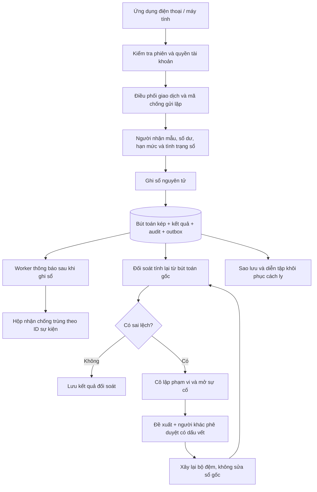
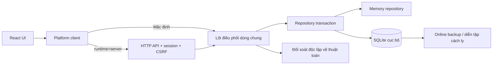

# Kiến trúc giao dịch NhTBank Sandbox

Nền nâng cấp: `main` tại `db6b58e`, ngày 29/10/2026. Người dùng yêu cầu tổ chức lại toàn bộ không gian mã và luồng giao dịch theo các khối A–M. Đây là thay đổi nghiệp vụ mô phỏng có chủ đích, không phải chỉnh giao diện đơn thuần. Giữ React 18, Vite, năm mục điều hướng, QR cục bộ và các bản xem trước di động.

## Luồng tổng thể

## Các bộ phận đã triển khai

| Khối  | Trách nhiệm                                                                                           | Điểm mã chính                                              |
| ----- | ----------------------------------------------------------------------------------------------------- | ---------------------------------------------------------- |
| A     | Giao diện hiện có và bảng vận hành responsive                                                         | `frontend/src/App.jsx`, `components/PlatformWorkspace.jsx` |
| B     | Phiên hết hạn, quyền theo vai trò, quyền ghi nợ tài khoản; máy chủ không tin role từ request          | `backend/src/server.js`, `packages/banking-core/model.js`  |
| C     | Khóa theo chủ thể + mã lệnh; so khớp nội dung; giữ nguyên kết quả đã chốt                             | `packages/banking-core/platform.js`                        |
| D     | Số nguyên VNĐ, người nhận mẫu, số dư, hạn mức UTC+7, kiểm tra sổ trước ghi nợ                         | `platform.js`, `reconciliation.js`                         |
| E     | Một unit of work đồng bộ; SQLite `BEGIN IMMEDIATE` / commit / rollback                                | `backend/src/sqlite-store.js`                              |
| F     | Sổ kép và kết quả/audit/sự kiện cùng transaction; bản ghi đã chốt chỉ thêm                            | `backend/migrations/001-ledger.sql`, `model.js`            |
| G     | Claim có lease và token, retry/backoff, hàng đợi lỗi, hộp nhận theo ID                                | `platform.js`, worker trong `server.js`                    |
| H/J/K | Thuật toán riêng tính tổng bút toán, kiểm tra cân bằng và liên kết kết quả/sự kiện; lưu từng lần chạy | `reconciliation.js`, `platform.js`                         |
| I     | SQLite online backup, SHA-256, kiểm tra toàn vẹn và đối soát bản sao cách ly                          | `backend/src/backups.js`                                   |
| L     | Khóa ghi nợ phạm vi ảnh hưởng, sự cố và nhật ký điều tra                                              | `platform.js`                                              |
| M     | Người đề xuất khác người phê duyệt; bằng chứng phải còn nguyên; đối soát lại trước bỏ cô lập          | `platform.js`                                              |

## Ranh giới thành phần

Lõi không import React, HTTP hoặc SQLite. Giao diện không tự trừ số dư nữa; nó gửi lệnh và đọc snapshot đã chốt. Hai repository dùng chung hợp đồng. Backend phục vụ cả bản web production và `/api/v1`; Vite có proxy cục bộ khi phát triển.

## Hai chế độ, hai vòng đời dữ liệu

- **Bộ nhớ, mặc định:** không gọi backend; tải lại hoặc đăng xuất đặt lại phiên. Vai trò chỉ là diễn tập trên trình duyệt. Bản chụp JSON mất theo phiên, không được gọi là sao lưu bền vững.
- **SQLite, `?runtime=server`:** cookie phiên HttpOnly/SameSite, API cùng nguồn; vai trò và quyền kiểm tra ở máy chủ. Tải lại hoặc đăng xuất không xóa sổ. Khởi động lại backend đọc DB đã có; phiên đăng nhập chỉ ở RAM và phải đăng nhập lại sau khi server khởi động lại.

Cả hai đều dùng PIN demo công khai `123456`, ba tài khoản mẫu và không có ngân hàng thật. Không thể dùng cơ chế này để bảo vệ dữ liệu hoặc tài sản thật.

## Mô hình dữ liệu

SQLite có `metadata`, `accounts`, `operations`, `transfers`, `ledger`, `audit`, `outbox`, `notifications`, `reconciliations`, `incidents`, `proposals`, `backups`. Mỗi tập có ID và thứ tự ổn định, JSON body có kiểm tra hợp lệ. Bút toán còn có cột số tiền nguyên, tài khoản và giao dịch với foreign key, cùng index tài khoản/giao dịch. Trigger cấm sửa/xóa sổ, audit, kết quả, mã lệnh, hộp nhận và kết quả đối soát.

Số dư mẫu mở đầu 4.056.000 VNĐ được ghi hai bút toán: tài khoản khách hàng +4.056.000 và nguồn mẫu −4.056.000. Bốn mục lịch sử cũ chỉ là dữ liệu giao diện minh họa ngoài số dư mở đầu; không ghi lại chúng vào sổ mới. Biểu đồ cũ không phải nguồn để đối soát sổ mới.

Chuyển tiền tạo hai bút toán: khách hàng −số tiền, tài khoản đối ứng Sandbox +số tiền. Chưa có thanh toán ra ngoài hoặc quyết toán ngân hàng. Mỗi nhóm bút toán phải tổng bằng 0; số dư bộ đệm phải bằng tổng bút toán của tài khoản. Thuật toán đối soát cộng bằng BigInt rồi kiểm tra miền số nguyên an toàn.

## Cô lập và xử lý

Sai lệch được ghi thành sự cố; tài khoản khách hàng ảnh hưởng bị cô lập. Nếu không xác định được phạm vi khách hàng từ sai lệch hệ thống thì cô lập các tài khoản khách hàng. Lệnh mới cũng kiểm tra tình trạng sổ trước ghi nợ. Mã lệnh đã ghi sổ vẫn tra lại đúng kết quả, không bị ghi nợ lần hai.

Chỉ hỗ trợ sửa **bộ đệm số dư** từ sổ gốc. Mọi lỗi bút toán, thiếu kết quả/sự kiện hoặc tổng không cân bằng phải điều tra thủ công; không có nút tự bù tiền. Người lập đề xuất không được tự duyệt, kể cả khi quyền của họ thay đổi. Nếu bằng chứng đổi, đề xuất phải lập lại. Áp dụng, đối soát lại, lưu kết quả, bỏ cô lập và audit nằm trong một transaction.

## Giới hạn cần giữ rõ

Đối soát độc lập về cách tính, chưa phải hệ thống ngân hàng/đơn vị kiểm toán bên ngoài. Worker và API có thể cùng tiến trình, không phải hạ tầng HA. SQLite phù hợp bản thử một nút; chưa có PostgreSQL, khóa phân tán, HSM/KMS, lưu audit WORM, sao lưu ngoài máy, đăng nhập thật, OTP hay kiểm toán tuân thủ. Không tự động công bố backend hoặc thay đổi quy tắc GitHub Pages.

Xem [bản đồ mã](workspace-map.md), [hợp đồng giao dịch](transaction-contract.md), [API](platform-api.md), [vận hành](operations-runbook.md), [mô hình an toàn](sandbox-security.md) và [kiểm chứng](platform-validation.md).

## Phần nâng cấp v2

[System v2](design/system-v2.md) là chi tiết thực thi mới nhất, bổ sung hai máy trạng thái và 9 sơ đồ. Receipt tiếp nhận được lưu bền trước transaction ghi sổ; trạng thái accepted khác posted. Lõi ghi sổ vẫn giữ toàn bộ số dư/bút toán/kết quả/audit/outbox nguyên tử. UI server lưu mã qua tải lại, tra cứu trước retry và không gán timeout thành thất bại.

Schema v2 migration từ v1 không sửa sổ gốc. Chuyển nội bộ cập nhật nguồn/đích trong cùng unit of work. Đảo có đề xuất/người duyệt riêng, thêm giao dịch bù; đối soát kiểm quan hệ chi tiết. Diễn tập khôi phục so cả dữ liệu/yêu cầu quanh mốc và chặn kết luận sẵn sàng khi còn dữ liệu thiếu. Chưa có thao tác thay DB thật hoặc mở lại DB phục hồi.
