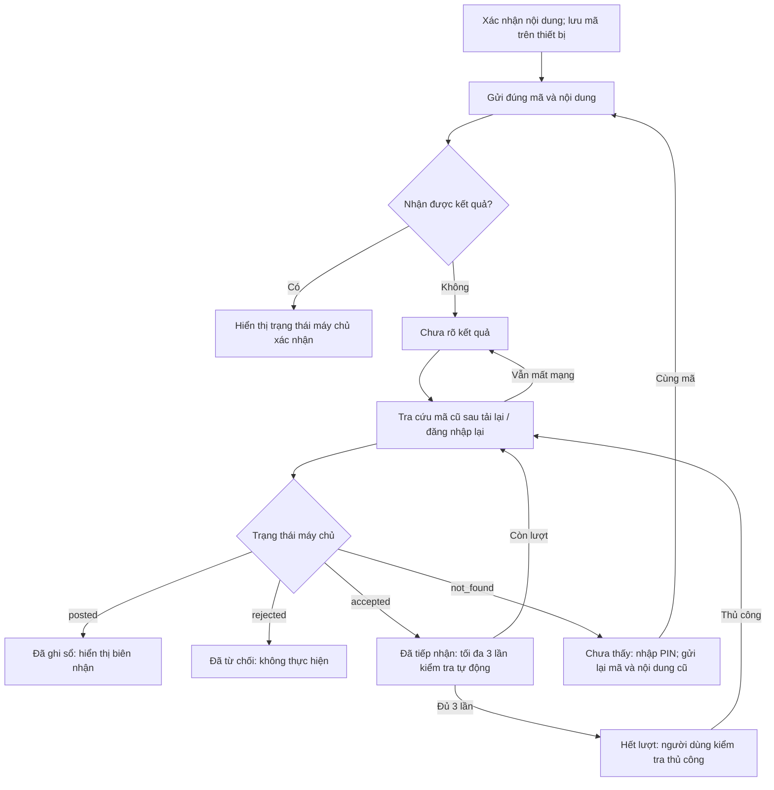
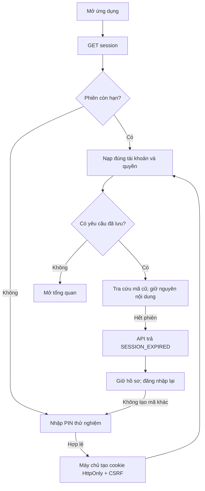
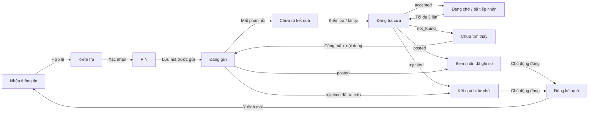
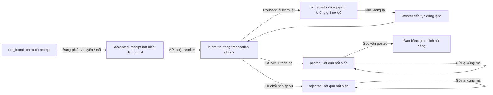
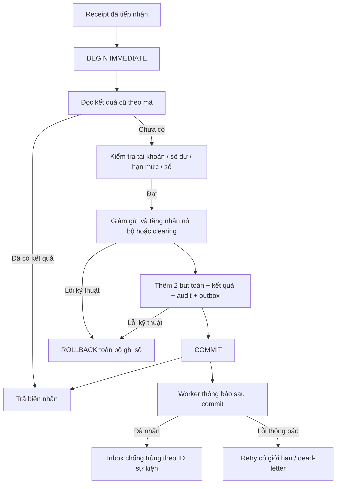
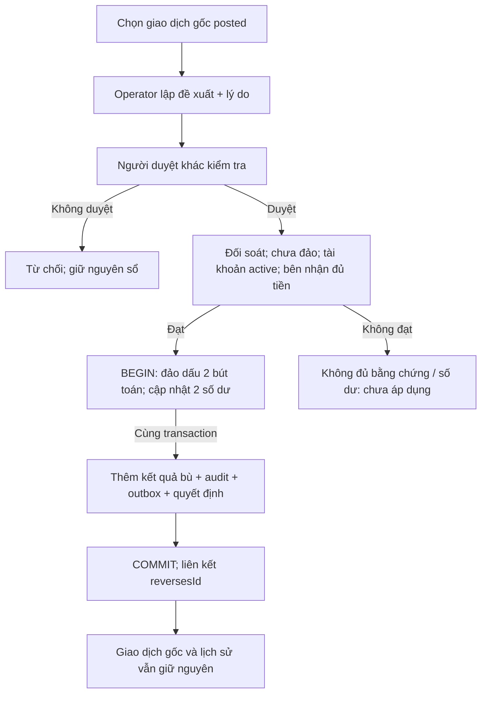
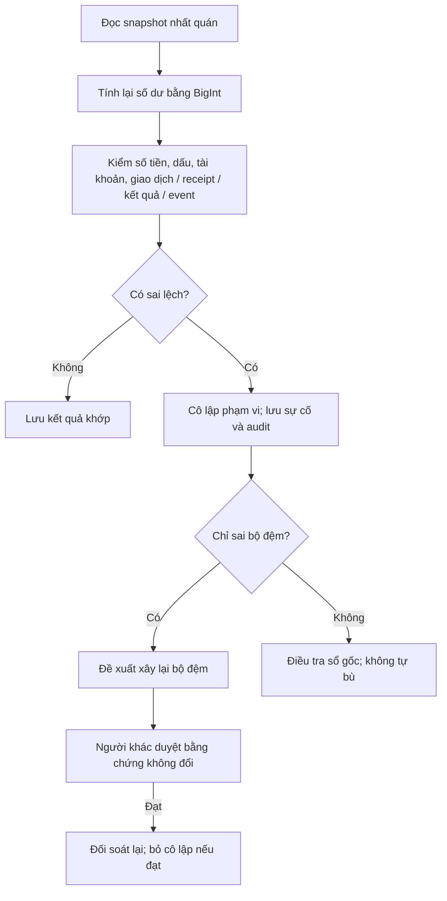
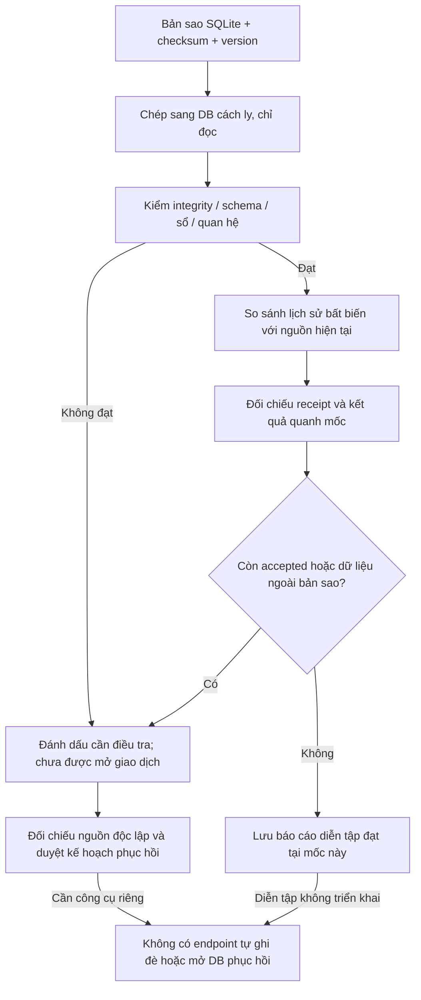
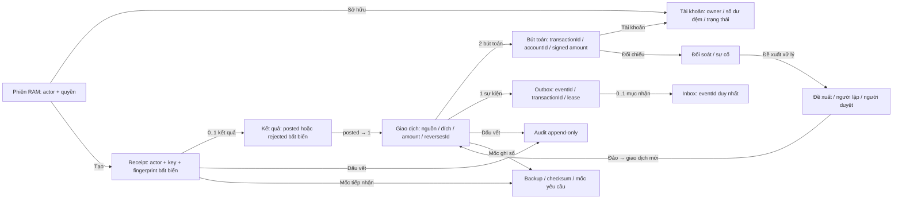

# NhTBank — hệ thống v2: giao dịch khi mất mạng

Cập nhật 29/10/2026. Phạm vi: Sandbox hiện có, Node 24 + SQLite và React. Mọi giá trị là mô phỏng; không có tiền thật hoặc API ngân hàng. Các sơ đồ phản ánh mã trong nhánh v2, không phải chứng nhận vận hành sản xuất.

## Quy tắc quan trọng nhất

**Không nhận được phản hồi không đồng nghĩa giao dịch thất bại.** Một ý định đã xác nhận có một mã yêu cầu và một nội dung bất biến. Chỉ tra cứu hoặc gửi lại đúng mã/nội dung đó. Không tạo mã mới chỉ vì timeout, HTTP 500, hết phiên, đóng tab hoặc tải lại trang.

- Chế độ `?runtime=server`: lưu hồ sơ lên `localStorage` **trước** POST, khóa Web Locks theo nguồn trang + chủ tài khoản, kiểm tra ghi thành công rồi mới gửi. Không lưu PIN, cookie hoặc CSRF vào hồ sơ này.
- Máy chủ commit receipt tiếp nhận riêng, rồi ghi sổ trong transaction khác. Mã chống lặp luôn có phạm vi `actorId:key` và fingerprint của lệnh chuẩn hóa. Ghi sổ thành công hoặc từ chối nghiệp vụ đều thành kết quả bất biến.
- Mất trang: phiên còn hạn được khôi phục; nếu cần, đăng nhập lại rồi tra cứu mã đã lưu. Không tự POST khi tải lại. Chỉ khi tra cứu trả `not_found`, người dùng nhập PIN và chủ động gửi lại nội dung đã lưu.
- `accepted` được kiểm tra tự động tối đa **3 lần** (1, 2, 4 giây); sau đó chỉ kiểm tra thủ công. API có timeout 12 giây. Worker tiếp tục các receipt đã nhận nhưng chưa có kết quả.
- `posted`: hiển thị biên nhận và focus tiêu đề; lỗi tải số dư hoặc lỗi thông báo không đổi kết quả đã chốt. `rejected`: ghi rõ máy chủ không thực hiện. Chỉ đóng hồ sơ cuối cùng khi người dùng chọn đóng kết quả/đi từ biên nhận.
- Hồ sơ chưa rõ kết quả không được bỏ để sửa nội dung hoặc tạo mã khác. Khóa giữa các tab ngăn tạo đồng thời; retry từ tab cũ phải khớp mã đang lưu, kể cả khi tab khác đã đóng kết quả.

## Hai máy trạng thái độc lập

| Trạng thái màn hình               | Ý nghĩa dữ liệu máy chủ                                   |
| --------------------------------- | --------------------------------------------------------- |
| Đang gửi / chưa rõ / đang tra cứu | Có thể chưa nhận, đã tiếp nhận, đã ghi sổ hoặc đã từ chối |
| Đang chờ                          | Đã nhận receipt, chưa có kết quả cuối                     |
| Biên nhận                         | Chỉ từ kết quả `posted` máy chủ xác nhận                  |
| Không thực hiện                   | Kết quả `rejected` được tra cứu xác nhận                  |

Trạng thái máy chủ: `not_found → accepted → posted/rejected`. `not_found` là quan sát tại thời điểm tra cứu, không phải bằng chứng một yêu cầu đang trên đường sẽ không đến. Vì vậy resend vẫn phải cùng mã. Lỗi kỹ thuật sau acceptance để receipt ở `accepted`; transaction ghi sổ rollback sạch và worker có thể tiếp tục. Phiên hết hạn không hủy lệnh đã được tiếp nhận hợp lệ. Worker chỉ xử lý chính xác receipt đã lưu; không nhận lệnh tùy ý từ trình duyệt.

## Ghi sổ và chuyển nội bộ

Lệnh gồm `accountId`, `bank`, `account`, `recipient`, `amount`, `note`. Dùng số nguyên VNĐ an toàn; kiểm tra hạn mức theo UTC+7 trong transaction ghi sổ. Receipt lưu JSON chuẩn hóa và fingerprint, không chứa PIN.

- Liên ngân hàng mô phỏng: giảm bên gửi, tăng `sandbox-clearing`. Tên người nhận chỉ kiểm định dạng, chưa được ngân hàng xác minh.
- Nội bộ `NhTBank Sandbox`: tra số tài khoản trong bộ dữ liệu, kiểm tên, loại tiền, khác nguồn và trạng thái active; giảm nguồn và tăng đúng đích trong **một transaction**. Tài khoản mẫu nhận `0900000002` — `Trần Minh Anh`, số dư đầu 0. Đây không phải tài khoản ngân hàng thật.
- Cùng transaction ghi sổ: 2 số dư, 2 bút toán có dấu, 1 giao dịch, 1 kết quả idempotency, audit, 1 sự kiện outbox. Lỗi bất kỳ sau khi bắt đầu ghi nợ rollback tất cả các phần này. Receipt tiếp nhận trước đó vẫn còn.
- Worker outbox hoạt động sau commit; lease/fencing, retry và inbox chống trùng tiếp tục độc lập. Không tuyên bố vận chuyển exactly-once.

## Đảo giao dịch

Operator đề xuất đảo **toàn phần** với lý do; approver khác người lập phải duyệt. Kiểm giao dịch gốc, chưa đảo, bằng chứng, sổ khớp, tài khoản active, số dư bên nhận đủ bù và giới hạn số nguyên.

Khi duyệt: cập nhật hai số dư + thêm hai bút toán ngược dấu + kết quả bù + audit + outbox + quyết định trong một transaction. Giao dịch mới có `kind: reversal`, `reversesId`, `proposalId`; bản gốc vẫn `posted`, không sửa/xóa. Duyệt lại cùng quyết định trả kết quả cũ, không thêm bút toán. Không có đảo một phần hoặc gọi hoàn tiền ngân hàng. Đảo không làm giảm doanh số hạn mức chuyển trong ngày.

## Đối soát và khôi phục

Đối soát tính lại số dư từ bút toán bằng BigInt, kiểm **đúng độ lớn, dấu, tài khoản nguồn/đích và quan hệ** receipt → kết quả → giao dịch → 2 bút toán → event, thêm phê duyệt và liên kết bù cho đảo. Hai bút toán cân tổng nhưng sai người/sai số tiền vẫn bị phát hiện. Sai sổ gốc cần điều tra; chỉ sai projection mới được đề xuất xây lại bộ đệm với người duyệt riêng.

Sao lưu ghi checksum, schema v2, version và số receipt/kết quả/bút toán ở snapshot đã chụp. Diễn tập sang DB cách ly, kiểm integrity + FK + schema + sổ và so sánh lịch sử bất biến với nguồn hiện tại. Báo cáo liệt kê receipt `accepted` tại mốc, receipt xuất hiện sau mốc, kết quả/bút toán thiếu và sự kiện/hộp nhận đã thay đổi sau mốc. Nguồn hiện tại chưa khớp sổ hoặc còn bị cô lập cũng chặn kết luận sẵn sàng.

Nếu còn yêu cầu chưa chốt hoặc thiếu dữ liệu sau mốc, đánh dấu `investigation-required`, `readyToOpen: false`; bản sao cân số dư vẫn **chưa đủ điều kiện mở lại giao dịch**. Báo cáo khớp chỉ là kết quả diễn tập tại thời điểm đó. Không có endpoint ghi đè DB đang chạy, tự replay lệnh sau sao lưu hay tự đưa DB phục hồi vào phục vụ. Khôi phục mất toàn bộ máy cần nguồn bền độc lập, kế hoạch replay/đối chiếu và phê duyệt; bản này chưa có nguồn đó.

## Dữ liệu và nâng schema

Schema **2** thêm bảng `requests` bất biến. Migration v1 → v2 giữ nguyên sổ, kết quả, audit đã chốt; bổ sung receipt từ fingerprint cũ để tra cứu lệnh lịch sử và thêm tài khoản nội bộ 0 đồng. Migration chạy trong SQL transaction, không xóa DB. Bản sao schema v1 không tự được mở như schema v2: cần quy trình chuyển đổi bản sao riêng rồi kiểm lại; chưa có công cụ tự chuyển backup cũ.

| Bản ghi                    | Quan hệ và chính sách                                                     |
| -------------------------- | ------------------------------------------------------------------------- |
| `requests`                 | ID `actor:key`, fingerprint + command, append-only; 0..1 kết quả          |
| `operations`               | ID bằng request; posted hoặc rejected, append-only                        |
| `transfers`                | Giao dịch posted, nguồn/đích/amount; reversal tham chiếu gốc, append-only |
| `ledger`                   | 2 bút toán/giao dịch; FK tài khoản + giao dịch, append-only               |
| `accounts`                 | Số dư projection và trạng thái; thay đổi qua unit of work                 |
| `outbox` / `notifications` | Sự kiện sau commit; inbox dùng ID sự kiện chống trùng                     |
| `proposals`                | Loại rebuild-projection hoặc reverse-transfer; maker khác checker         |
| `backups`                  | Checksum, mốc snapshot, báo cáo các yêu cầu quanh mốc                     |

## Sơ đồ và nguồn chỉnh sửa

Mermaid `.mmd` và Graphviz `.dot` được sinh từ cùng định nghĩa trong [render-diagrams.py](render-diagrams.py). SVG/PNG là xuất bằng Graphviz; khác cách bố trí Mermaid, cùng nội dung luồng. Chạy `python3 docs/design/render-diagrams.py` (cần `dot`) để cập nhật đồng thời các nguồn và ảnh. Đây là tệp chỉnh sửa trong repo; không tuyên bố đã tạo tài liệu trong MagicPath/Sites/Canva.

### Mất mạng khi chuyển tiền

[SVG](diagrams/01-network-loss.svg) · [PNG](diagrams/01-network-loss.png) · [Mermaid](diagrams/01-network-loss.mmd) · [DOT](diagrams/01-network-loss.dot)

### Đăng nhập và hết phiên

[SVG](diagrams/02-session.svg) · [PNG](diagrams/02-session.png) · [Mermaid](diagrams/02-session.mmd) · [DOT](diagrams/02-session.dot)

### Máy trạng thái màn hình

[SVG](diagrams/03-screen-state.svg) · [PNG](diagrams/03-screen-state.png) · [Mermaid](diagrams/03-screen-state.mmd) · [DOT](diagrams/03-screen-state.dot)

### Máy trạng thái giao dịch máy chủ

[SVG](diagrams/04-transaction-state.svg) · [PNG](diagrams/04-transaction-state.png) · [Mermaid](diagrams/04-transaction-state.mmd) · [DOT](diagrams/04-transaction-state.dot)

### Ghi sổ nguyên tử và thông báo

[SVG](diagrams/05-ledger.svg) · [PNG](diagrams/05-ledger.png) · [Mermaid](diagrams/05-ledger.mmd) · [DOT](diagrams/05-ledger.dot)

### Đảo giao dịch có dấu vết

[SVG](diagrams/06-reversal.svg) · [PNG](diagrams/06-reversal.png) · [Mermaid](diagrams/06-reversal.mmd) · [DOT](diagrams/06-reversal.dot)

### Đối soát và cô lập

[SVG](diagrams/07-reconciliation.svg) · [PNG](diagrams/07-reconciliation.png) · [Mermaid](diagrams/07-reconciliation.mmd) · [DOT](diagrams/07-reconciliation.dot)

### Kiểm tra mốc khôi phục

[SVG](diagrams/08-recovery.svg) · [PNG](diagrams/08-recovery.png) · [Mermaid](diagrams/08-recovery.mmd) · [DOT](diagrams/08-recovery.dot)

### Quan hệ dữ liệu

[SVG](diagrams/09-data-relations.svg) · [PNG](diagrams/09-data-relations.png) · [Mermaid](diagrams/09-data-relations.mmd) · [DOT](diagrams/09-data-relations.dot)

## Cách kiểm tra và giới hạn

Xem [kết quả kiểm tra v2](../system-v2-validation.md), [API](../platform-api.md), [hợp đồng giao dịch](../transaction-contract.md) và [runbook](../operations-runbook.md).

Chống gửi lặp qua tải lại áp dụng cho chế độ server, cùng origin và cùng chủ thể với hồ sơ trình duyệt còn nguyên. Bản memory vẫn mất sổ khi tải lại và không giả lập dữ liệu bền. Nếu xóa storage, đổi origin/thiết bị, máy chủ bị khôi phục mất các receipt mới hơn hoặc cố tình tạo mã khác, không có bảo đảm nối lại ý định tự động. Kiểm tra lịch sử/nhờ vận hành trước khi tạo lệnh mới. Chưa có offline-shell/PWA; cần kết nối để tải web và khôi phục phiên sau khi mở lại. Cần HTTPS/localhost hỗ trợ Web Locks; thiếu bộ nhớ hoặc khóa thì chặn gửi mới. Hồ sơ chứa thông tin chuyển tiền mẫu, chưa mã hóa; không đưa dữ liệu thật vào Sandbox.

Phiên và các danh tính/PIN public chỉ để thử; chưa có MFA, kiểm soát quản trị sản xuất, HSM/WORM, sao lưu ngoài máy, RPO/RTO đo đạc, cluster HA hoặc chứng nhận ngân hàng. Chưa kiểm tra thiết bị Android/iPhone thật, bàn phím ảo hay hiệu năng thực địa.
