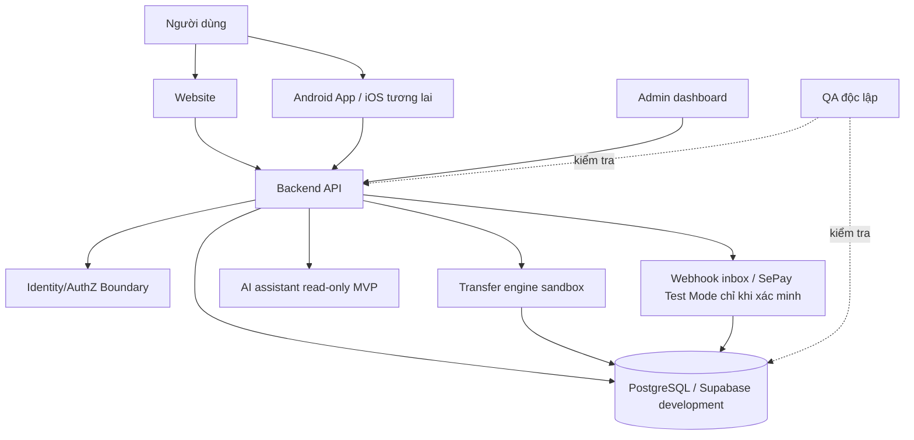

# ARCHITECTURE – NhTBank (bản phác thảo)

> **BẢN NHÁP – 2026-11-01**  
> Phạm vi: phân tích và điều phối; chưa kiểm tra GitHub trực tiếp trong lượt này; không chạy SQL, không ghi repository, không merge/deploy.  
> Quy ước: **KNOWN-HISTORICAL** = thông tin ghi nhận từ công việc trước, chưa xác minh lại; **PROPOSED** = đề xuất; **NOT RUN** = chưa chạy; **BLOCKED** = chờ điều kiện/bằng chứng; **VERIFIED** chỉ khi có bằng chứng hiện thời.

## Thành phần và luồng đề xuất

## Hợp đồng chưa chốt

1. Identity: xác minh principal đáng tin ở backend; front-end không tự quyết định phân quyền.
2. Giao dịch: sandbox VND; atomic mutation; idempotency bằng `(principal_key, operation_scope, idempotency_key)` và canonical request hash.
3. Dữ liệu: service_role quyền tối thiểu; schema `private` không exposed; RLS và ACL cần kiểm chứng; không ghi secrets/OTP trong audit.
4. Webhook: xác thực nguồn, chống trùng và retry; chỉ dùng API/Test Mode thực tế đã xác minh.
5. AI: đọc dữ liệu được cấp quyền; không có quyền sửa số dư hay chuyển tiền.
6. Trải nghiệm: web/mobile dùng chung design tokens, nhưng có các luồng bảo mật riêng theo nền tảng.

## Phụ thuộc cần khóa

- Nhóm 10 → 02 (business scope → API).
- Nhóm 02 + 06 + 07 → 08 (contract + auth + schema → transfer engine).
- Nhóm 03 + 02 + 06 → 04/05 (design + API + security → UI).
- Nhóm 06 + 07 + 08 → 13 (threat model + schema + transfer → security testing).
- Nhóm 13 → 14 (gates → CI/release policy).

## Ngoài phạm vi hiện tại

Production, ngân hàng thật, chuyển khoản thật, reversal workflow, sử dụng v3 runner cho SQL v2 và phát hành app.

## Phụ lục điều phối v2 (2026-11-05, PROPOSED)

- Nguồn phụ thuộc chi tiết là `MASTER-STATUS.md` v2, mục 2; sơ đồ trong tài liệu này chỉ thể hiện ràng buộc chính.
- Cặp 07 (DB) và 08 (Backend) trao đổi schema draft ↔ transaction/idempotency contract hai vòng; 06 và 13 phản biện.
- Gate: ARCH-01, SEC-01, DB-01, TX-01, UX-01. Chưa có gate nào được xác minh là PASS.